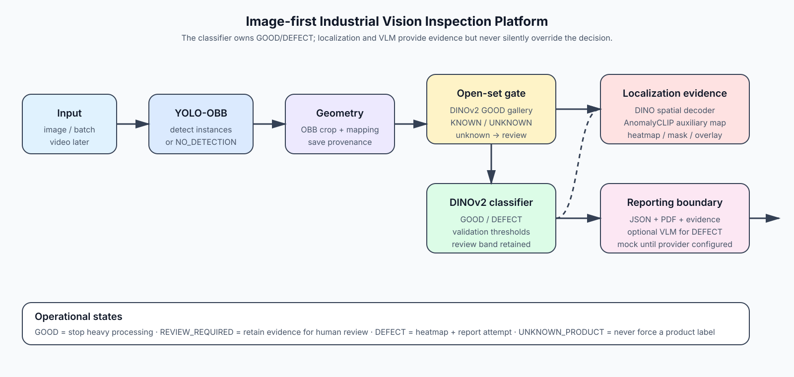
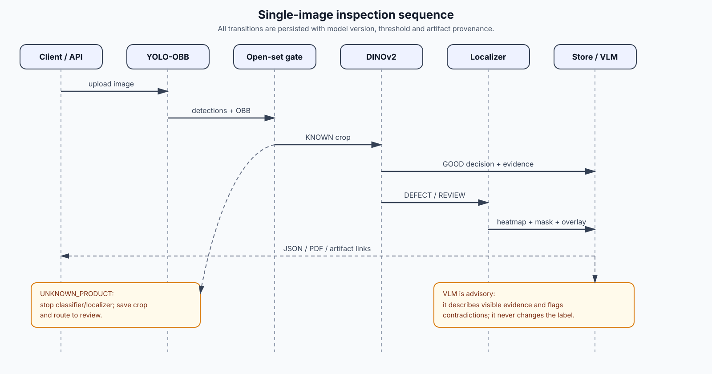
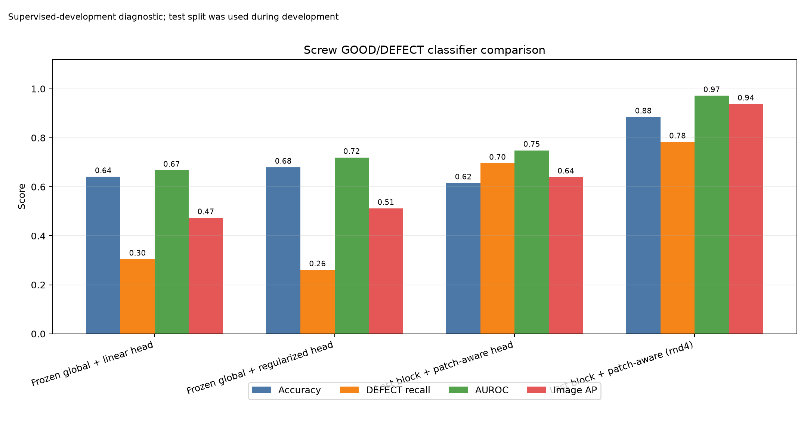
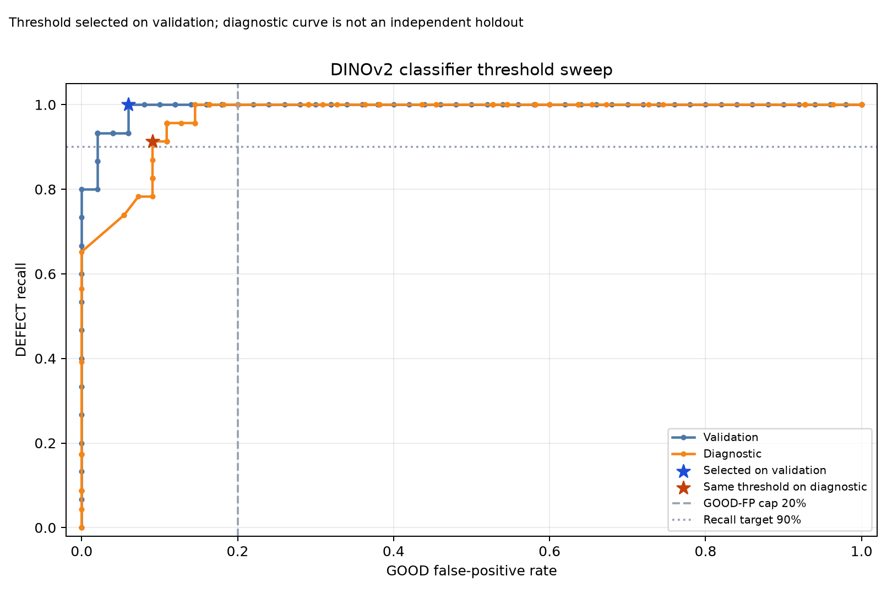
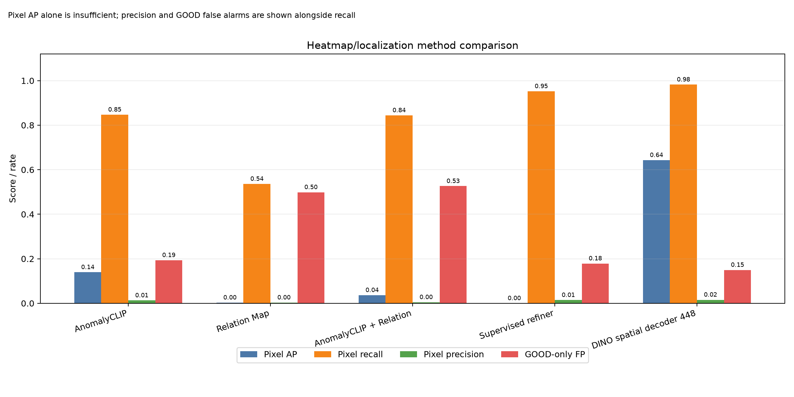
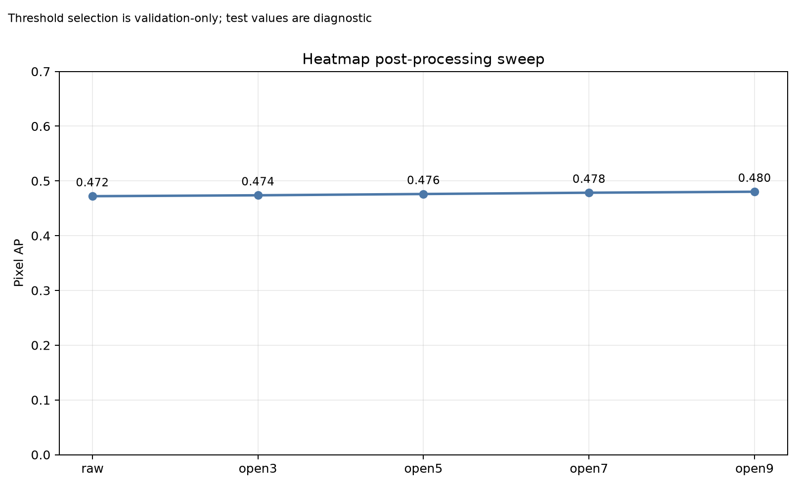
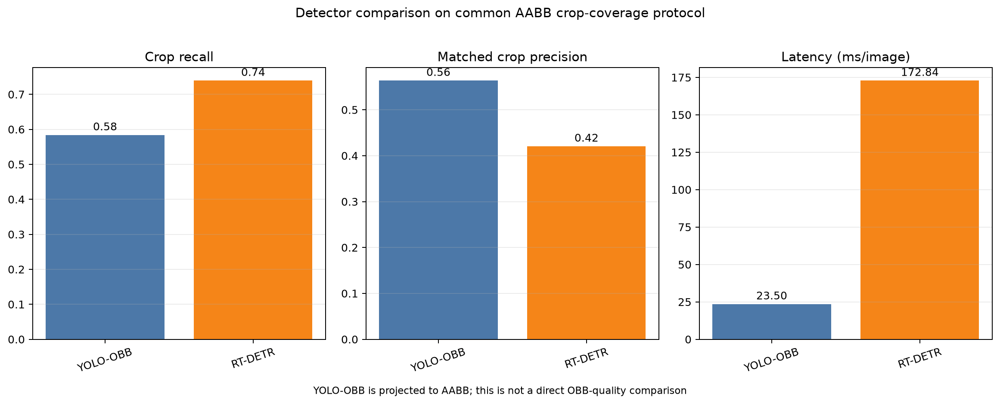
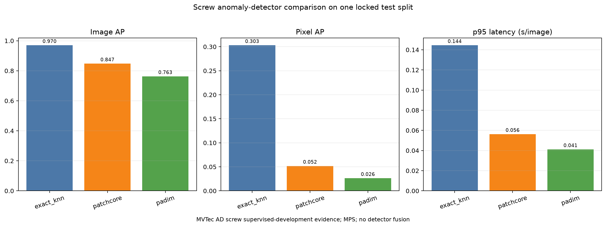

# Industrial Vision Anomaly Detection — Thesis Report Pack

This document is the report-facing index for the image-first screw inspection
pilot. It links to reproducible source reports and generated figures so the
thesis can distinguish completed evidence from planned work.

## Evidence status

| Area | Current evidence | Status for a final claim |
|---|---|---|
| Detector | YOLO-OBB and RT-DETR comparison on a common AABB crop protocol | Development/diagnostic; target-camera holdout still required |
| Product recognition | DINOv2 GOOD gallery with UNKNOWN rejection | Prototype; external known/unknown holdout still required |
| GOOD/DEFECT classification | DINOv2 last-block patch-aware candidate and one-class patch-memory candidate | Strong development candidates; no independent integrated benchmark yet |
| Localization | DINO spatial decoder 448, AnomalyCLIP baseline, supervised refiner, Relation Map ablations | 448 decoder is the strongest development candidate; precision and Dice remain weak |
| VLM | Mock/cache/validation boundary | Cloud provider is intentionally not configured |
| Sweep | Validation-only threshold/operating-point selector with split and artifact hashes | Implemented protocol guard; not a model trainer |

## Architecture figures





The binary classifier owns the GOOD/DEFECT label. `REVIEW_REQUIRED` and
`UNKNOWN_PRODUCT` are operational dispositions, not additional classifier
classes. Heatmaps and VLM reports are evidence and explanation layers.

## Generated benchmark figures

The figure pack was rendered by
[`scripts/render_thesis_report.py`](../scripts/render_thesis_report.py).
The output manifest records the SHA-256 of every source report and generated
image:

[`report_manifest.json`](../reports/experiments/thesis_figures_rnd15/report_manifest.json)

### Classification comparison



Source reports include the frozen global baseline, the regularized head and the
last-block patch-aware head. The raw-score ranking metrics on the saved
development split are AUROC `0.9715` and image AP `0.9377`. Under the current
validation-only gate, the formal ledger (`rnd10`) selects threshold `0.389671`;
the diagnostic/test alias reaches DEFECT recall `21/23 = 0.9130` and GOOD-FP
`5/55 = 0.0909`. These values are development evidence, not an independent
production estimate.

### Classification threshold sweep



The reconciled threshold report and the formal ledger now use the same declared
classifier operating-point policy: maximize validation DEFECT recall, then
minimize GOOD-FP, then choose the higher threshold. The selected threshold is
`0.389671`, giving validation `15/15 = 1.0000` recall and `3/50 = 0.0600`
GOOD-FP; the same threshold reaches diagnostic `21/23 = 0.9130` recall and
`5/55 = 0.0909` GOOD-FP. This is a useful development result, but it is not an
independent target-camera holdout. The formal ledger and locked split hashes
are available in
[`manifest.json`](../reports/experiments/screw_classifier_sweep_rnd10/ledger/manifest.json),
[`selected_candidate.json`](../reports/experiments/screw_classifier_sweep_rnd10/ledger/selected_candidate.json),
and [`diagnostic_evidence.json`](../reports/experiments/screw_classifier_sweep_rnd10/diagnostic_evidence.json).
The diagnostic manifest is explicitly an alias of the saved test manifest; it
is not a second independent sample.
The earlier `0.819638` result remains an archived alternative policy run and is
not used by the thesis operating point.

### Localization method comparison



The 448-pixel spatial decoder has the highest saved development Pixel AP
(`0.6430`) and pixel recall (`0.9823`) among the plotted candidates, but its
pixel precision is only `0.0156` and its mean predicted area is much larger
than the ground-truth area. It is therefore a high-recall evidence candidate,
not a precise defect boundary.

### Post-processing sweep



The morphology sweep improves the active refiner's Pixel AP only slightly
(`0.4721` raw to `0.4803` with `open9`). The improvement is not large enough
to justify changing the main production configuration.

### Detector coverage and latency



This is a common AABB crop-coverage protocol. YOLO-OBB predictions are
projected to AABBs so the comparison must not be presented as a direct OBB
quality comparison. YOLO-OBB is the practical latency candidate; RT-DETR has
higher coverage but is substantially slower and less precise on matched crops.
The direct detector source is
[`weee_yolo_obb_rtdetr_fair_aabb_holdout_rnd3.json`](../reports/experiments/weee_yolo_obb_rtdetr_fair_aabb_holdout_rnd3.json),
tracked by `AT-DETECT-FAIR-001`; it has not yet been evaluated through the
downstream anomaly stages. On the locked test, YOLO-OBB reaches `244/418 =
58.37%` crop recall with `189` unmatched predictions; RT-DETR reaches
`309/418 = 73.92%` with `426` unmatched predictions. The corresponding
per-object manifests are
[`YOLO-OBB`](../reports/experiments/weee_yolo_obb_rtdetr_fair_aabb_holdout_rnd3_yolo_obb_projected_aabb_crop_manifest.jsonl)
and
[`RT-DETR`](../reports/experiments/weee_yolo_obb_rtdetr_fair_aabb_holdout_rnd3_rtdetr_aabb_crop_manifest.jsonl).

### Anomaly detector comparison



The three anomaly branches were run independently on the same 160-image MVTec
AD screw test split. Exact kNN is the strongest image-level ranking baseline
(`Image AP 0.9696`) and also has the highest Pixel AP among these three
branches (`0.3030`). PatchCore and PaDiM are retained as independent
localization comparisons, not as additional classification authorities. Their
p95 inference times are `56.2 ms` and `41.1 ms` per image respectively, versus
`144.4 ms` for Exact kNN; the timings include the shared DINOv2 forward and
routing. The sequential three-detector run is `37.66 s / 160 images`, or
`235.4 ms/image`; official fusion remains disabled.

The source report is
[`comparison_summary.json`](../reports/production/screw_comparison_rnd6/mvtec_ad_screw_benchmark/20261122T201103Z/comparison_summary.json).
The report now pins the classification-split hash, canonical test-manifest
hash, dataset provenance hash and validation-report hash, and stores raw
image/pixel TP/FP/FN/TN counts beside each derived metric. It is still
supervised-development evidence from MVTec AD, not a target-camera production
estimate.

## Qualitative figures


The montage contains detector predictions, a known-product inspection with
heatmap evidence, and an UNKNOWN-product rejection. These are smoke/development
artefacts and are useful for the qualitative chapter, but they must not be
described as a statistically representative error gallery.

## Deployment workflow for the image-first vertical slice

The implementation is configuration-driven. A reproducible pilot deployment
follows this sequence:

```text
dataset + product YAML
        -> validate-dataset
        -> train/calibrate/export versioned model bundle
        -> FastAPI factory (one bounded GPU worker)
        -> POST image + optional product_key override
        -> poll inspection status
        -> retrieve JSON, overview, crops, heatmap and PDF artifacts
```

Representative commands are:

```bash
PYTHONPATH=src DAenv/bin/python -m inspection.cli \
  validate-dataset --config configs/products/screw.yaml

PYTHONPATH=src DAenv/bin/python -m inspection.cli \
  inspect --config configs/experiments/screw_open_set_candidate.yaml \
  --image path/to/image.png --inspection-id demo_001

PYTHONPATH=src uvicorn inspection.api:create_app --factory \
  --app-dir src --host 127.0.0.1 --port 8000
```

The API contract is `POST /api/v1/inspections`, followed by
`GET /api/v1/inspections/{inspection_id}` and the artifact endpoints. The
primary auto-routing path omits `product_key`; when it is present, the field is
an explicit diagnostic/operational override and must be recorded in provenance.
The runtime preserves per-object `KNOWN_PRODUCT`/`UNKNOWN`, `GOOD`/`DEFECT`,
`REVIEW_REQUIRED` and `STAGE_FAILED` states; heatmaps and VLM output are
evidence layers and cannot override the classifier. The current deployment
boundary is still a static-image pilot: live video, authentication, tenant
isolation, and a configured cloud VLM are not release-ready.

For a future labelled target-camera holdout, use
[`evaluate_dinov2_classifier_holdout.py`](../scripts/evaluate_dinov2_classifier_holdout.py).
It consumes a locked `image_path,label` CSV, receives the already selected
validation threshold plus `--selection-ledger`, verifies the threshold/model/
manifest hashes against the ledger, and writes exact confusion counts without
tuning on the holdout. The current external MVTec screw annotation JSON is reserved for
unknown-product/open-set evidence and is not a GOOD/DEFECT holdout.

## Experiment table for the thesis

| Experiment | Train data | Selection data | Evaluation data | Primary metrics | Decision |
|---|---|---|---|---|---|
| YOLO-OBB vs RT-DETR | WEEE train/validation | validation confidence | locked WEEE test | crop recall, match precision, IoU, latency | Keep YOLO-OBB as practical baseline; retain RT-DETR as coverage comparison |
| Exact kNN / PatchCore / PaDiM | MVTec AD screw train | validation acceptance thresholds | common 160-image screw test | Image AP, Pixel AP, Pixel F1, p95 latency | Keep Exact kNN as image-level baseline; retain PatchCore and PaDiM as independent evidence branches |
| DINOv2 classifier heads | 333 object crops | 69 validation objects | 78 development objects | accuracy, DEFECT recall, AUROC, image AP | Keep last-block patch-aware candidate for further validation |
| Patch-memory classifier | GOOD memory only | disjoint calibration GOOD set | CAD-SD and MVTec diagnostic tests | recall, GOOD FP, AUROC, AP | Strong image-level candidate; not yet wired into main product config |
| AnomalyCLIP baseline | configured localizer data | validation mask threshold | development test | Pixel AP, precision, recall, Dice, IoU | Keep as auxiliary evidence |
| Relation Map | same localization data | validation-only fusion | development test | Pixel AP and GOOD FP | Disabled; regressed on screw domain |
| DINO spatial decoder 448 | 333 train objects | 69 validation objects | 78 development objects | Pixel AP, recall, precision, GOOD FP | Best saved heatmap candidate; needs independent holdout |
| Heatmap morphology sweep | same active refiner | validation policy | development test | Pixel AP and false alarms | Small improvement only; no production change |

## Reproducibility and validity rules

1. Never select a threshold using the final holdout.
2. Split by source identity/physical instance where possible.
3. Store split, config, model and report hashes in the sweep manifest.
4. Report both numerator/denominator and the derived metric.
5. Report image-level and pixel-level metrics separately.
6. Do not infer localization quality from Pixel AP alone.
7. Do not let a heatmap or VLM override the classifier label.
8. Mark all MVTec-derived development results as development evidence until a
   fresh target-camera/physical-instance holdout is locked.

## Remaining gates before a final thesis claim

- Acquire and lock a target-camera independent holdout.
- Repair or explicitly approve the detector calibration target.
- Run the DINOv2 classifier threshold sweep on validation candidates, then
  evaluate once on the locked holdout; detector and localization sweeps still
  need the same execution-to-ledger wiring.
- Repeat the complete pipeline benchmark, including detector misses, UNKNOWN
  rejection, classifier errors, localization and total latency.
- Add representative true-positive, false-positive and false-negative image
  galleries from the locked holdout.
- Configure and evaluate a real VLM provider only after the deterministic
  pipeline is accepted.

## Reproduction commands

```bash
MPLBACKEND=Agg PYTHONDONTWRITEBYTECODE=1 PYTHONPATH=src:. DAenv/bin/python \
  scripts/render_thesis_report.py \
  --output-dir reports/experiments/thesis_figures_rnd15

PYTHONPATH=src DAenv/bin/python -m unittest discover -s tests -q
```

The renderer refuses to overwrite an existing output directory. Use a new
run identifier for each figure pack.
