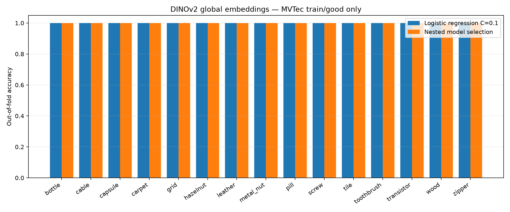

# DINOv2 15-category classification: nested GOOD-only CV

**Status: exploratory in-domain result.** This run estimates product-category recognition on held-out MVTec `train/good` images. It is not a fresh production-camera result and does not validate defect recognition or unknown-product rejection.

## Protocol

- 2,540 images from the existing training partition, covering all 15 MVTec categories; frozen DINOv2 ViT-B/14 global CLS embeddings (`x_norm_clstoken`, 768 dimensions).
- Five outer `StratifiedGroupKFold` folds generate out-of-fold predictions. Four inner folds choose the classifier and hyperparameters using balanced accuracy.
- The group key is SHA-256 of decoded RGB pixels, so exact duplicate images stay together. The source manifest has no physical-object or acquisition-session IDs; the split cannot rule out those forms of dependence.
- Compared the current fixed multinomial logistic regression (`C=0.1`) with inner-fold selection among logistic regression, linear SVM, RBF SVM and cosine kNN. Only the training embedding file was loaded; validation and official test embeddings were not loaded.
- Seed: `20261126`. The script and artifact hashes, manifest hash, package versions, fold metrics and selected parameters are recorded in [`summary.json`](summary.json).

## Result

| Method | Out-of-fold Top-1 | Macro Top-1 | Macro F1 |
|---|---:|---:|---:|
| Current logistic regression, `C=0.1` | **100.00%** | **100.00%** | **100.00%** |
| Nested model/parameter selection | **100.00%** | **100.00%** | **100.00%** |

The nested search selected logistic regression with `C=0.01` in all five outer folds. Every category scored 100% under both methods. The search therefore found no measurable improvement over the current classifier; retain the current production setting pending a broader validation set.



Fold-level outcomes and per-category values are available in [`fold_metrics.csv`](fold_metrics.csv) and [`per_category.csv`](per_category.csv). [`per_image_oof.csv`](per_image_oof.csv) records every held-out image, decoded-pixel group hash, outer fold, true category and both predictions for independent row-level checking.

## Limits

- All evaluated images are GOOD. This run does not establish accuracy on defects, UNKNOWN false-accept rate, or deployment camera/domain shift.
- The known MVTec official test has influenced earlier method choices. This CV avoided that test, but it only measures the existing MVTec training distribution and cannot serve as the project’s final independent acceptance set.
- Exact decoded-pixel grouping does not substitute for object/session grouping. The source dataset does not supply those IDs.
- No production classifier weights were changed based on this experiment. The 100% score is an in-domain result and should not be presented as a universal accuracy claim.

## Reproduce

The script requires the local `train_embeddings.pt` and `embedding_metadata.json` produced by the project pipeline under `artifacts/production_highres/mvtec_ad/embeddings`, plus the processed MVTec images under `datasets/mvtec_ad_processed_320`. These data and cache files are not in Git, so a clean checkout needs the MVTec dataset and project preprocessing/embedding step before the CV can run. Verify the manifest and embedding hashes against `summary.json` before interpreting a reproduction.

From the repository root, create an isolated Python 3.13 environment, install the recorded package versions, and use a new output directory:

```bash
python3.13 -m venv /tmp/ivision_goal_env
/tmp/ivision_goal_env/bin/python -m pip install torch==2.15.0 torchvision==0.29.2 scikit-learn==1.9.1 Pillow==13.0.0 numpy==2.5.5 matplotlib==3.11.2
/tmp/ivision_goal_env/bin/python reports/classification_evaluation/nested_good_embedding_cv.py \
  --output /tmp/goal_15_category_classification_nested_cv_reproduction
```

The output directory must not already exist. In the recorded run, PyTorch 2.15.0 loaded the `.pt` cache; the CV models ran through scikit-learn on CPU. MPS availability was checked but not used for this experiment.
