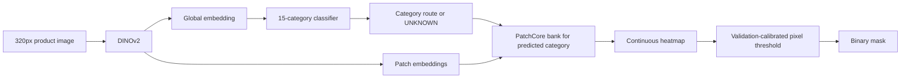
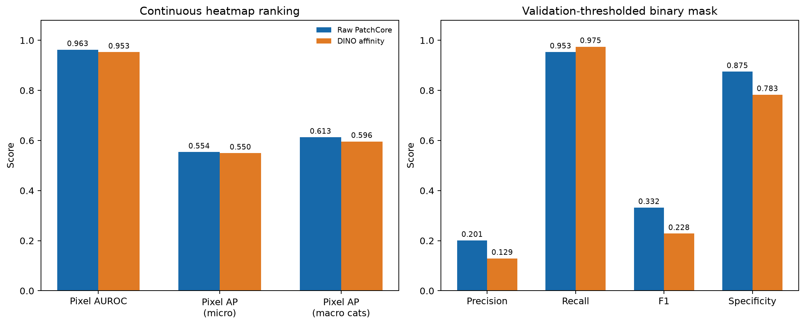
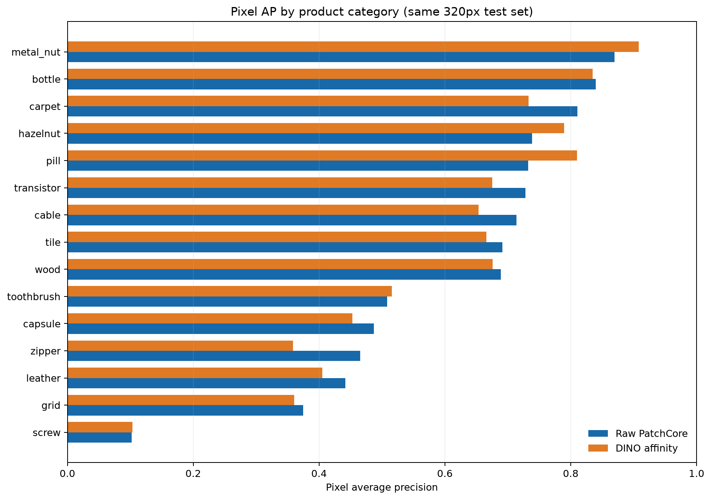
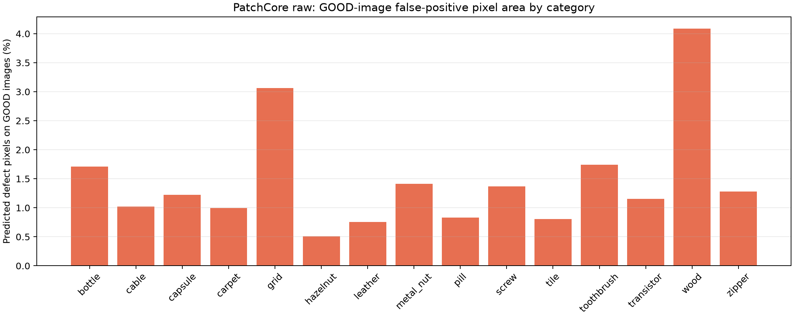
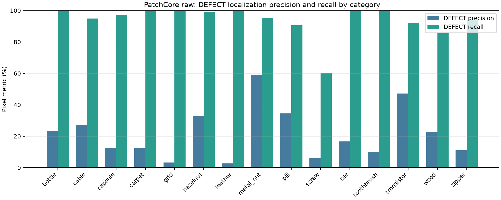

# MVTec AD 15-category benchmark: PatchCore heatmaps

**Status: exploratory development benchmark.** The official MVTec test split has been viewed in prior experiments and used for method/resolution choices. The numbers below are useful for comparing these two recorded runs, but they are not an unbiased final generalization estimate.

## Experiment protocol

Both runs use the same processed 320×320 MVTec AD data, 15 categories, DINOv2 backbone, PatchCore banks, validation split, classifier, confidence threshold (0.50), and test images. The only intended method change is the PatchCore patch-score refiner:

| Run | Heatmap method | Affinity settings | Binary-mask processing |
|---|---|---|---|
| Raw PatchCore | Unrefined patch scores | None | Raw thresholded map |
| DINO affinity | Sparse cosine-affinity propagation | `top_k=128`, `temperature=0.10`, `eta=1.0` | Raw thresholded map |

Pixel thresholds were calibrated from held-out normal validation images only, using the existing 0.99 quantile policy. Test masks were used only to calculate reported metrics, not to select those thresholds.

When the category classifier rejects a low-confidence image, the user-facing class remains UNKNOWN. The independent localization benchmark still uses the classifier's predicted candidate category to select a PatchCore bank, so those rejected cases can be evaluated for heatmap coverage. This routing candidate is not treated as an accepted classification result.

## Results

### Classification

| Metric | Result |
|---|---:|
| Test images | 1,725 |
| Top-1 accuracy, rejected cases counted wrong | **99.83%** |
| Accuracy among accepted predictions | 100.00% |
| UNKNOWN/rejected | 3 (0.17%) |
| Macro precision / recall / F1 | 1.0000 / 0.9982 / 0.9991 |

The 99.83% all-image accuracy exceeds the >90% project target for this closed-set test. The three rejects were low-confidence defects from cable (1) and transistor (2); all other accepted predictions were correct. The accepted-only 100% must not be presented as the overall accuracy.

### Heatmap and mask comparison

| Metric | Raw PatchCore | DINO affinity | Better result |
|---|---:|---:|---|
| Pixel AUROC | **0.96265** | 0.95283 | Raw |
| Pixel AP, micro | **0.55376** | 0.54960 | Raw |
| Pixel AP, macro mean across 15 categories | **0.61279** | 0.59618 | Raw |
| Pixel precision at validation threshold | **0.20106** | 0.12925 | Raw |
| Pixel recall at validation threshold | 0.95327 | **0.97470** | Affinity |
| Pixel F1 / Dice | **0.33208** | 0.22824 | Raw |
| Pixel specificity | **0.87477** | 0.78292 | Raw |
| IoU | **0.19910** | 0.12882 | Raw |
| Map and mask coverage | 100% (1,725/1,725) | 100% (1,725/1,725) | Tie |
| Mean inference latency | **0.3818 s/image** | 0.3910 s/image | Raw |

The raw heatmap has better overall Pixel AP, AUROC, precision, F1, specificity, and IoU. DINO affinity raises recall by about 2.14 percentage points, while lowering precision by about 7.18 points and mask F1 by about 10.38 points. Since the goal includes showing the user a tight defect region, the higher recall alone does not justify choosing affinity.

Both methods still produce broad masks at the selected validation thresholds: raw PatchCore precision is about 20%, despite recall around 95%. This remains a heatmap-localization weakness.

### Pixel AP by category

Raw PatchCore's macro category AP is 0.61279; DINO affinity's is 0.59618. The raw method is stronger in 10 of 15 categories. The weakest category for both is **screw** (0.10235 raw; 0.10306 affinity), so the screw failure is not fixed by this affinity setting.

The weakest raw categories are screw (0.102), grid (0.375), leather (0.442), zipper (0.465), and capsule (0.487). Improvements should be evaluated by category so aggregate results do not hide these cases.

### GOOD and DEFECT localization audit

A same-configuration raw PatchCore rerun produced explicit subgroup metrics for all 1,725 test images. The prediction scores, masks and validation thresholds match the raw baseline; this run adds coverage and subgroup reporting.

| Subgroup metric | Result |
|---|---:|
| GOOD map/mask coverage | 467/467 (100%) |
| GOOD false-positive pixel area | 1.29% |
| Mean predicted mask on GOOD images | 1,320.6 px (1.29% of a 320×320 image) |
| DEFECT map/mask coverage | 1,258/1,258 (100%) |
| DEFECT-only Pixel AUROC / AP | 0.95361 / 0.55712 |
| DEFECT precision / recall / F1 | 0.20579 / 0.95327 / 0.33851 |
| DEFECT Dice / IoU | 0.33851 / 0.20374 |

The GOOD false-positive pixel area is calculated only over GOOD images with predicted masks and must be read together with mask coverage. Coverage is 100% here. On defective images, precision remains only 20.58%: high defect recall does not mean the marked region is tight, and substantial spill around the ground-truth defect remains.

The schema-refresh rerun is recorded at [`20261126T072127Z`](../goal_15_category_postpatch_qa/mvtec_ad/20261126T072127Z/final_report.md). It reused the raw PatchCore configuration, cached banks, split and thresholds. Its saved JSON is the source for the subgroup CSV and Markdown refresh; the only additional count is `defect_image_count`, derived from validated category split counts. The three saved error rows were extended with audit columns: localization category comes from the classifier's predicted candidate, while anomaly decision/source/status preserve the saved detector decision and run configuration. No prediction, score or threshold was changed during that report refresh. See the [run provenance and artifact hashes](../goal_15_category_postpatch_qa/mvtec_ad/20261126T072127Z/benchmark_provenance.json).

## Decision

Keep **raw PatchCore at 320px** as the current 15-category heatmap baseline. Do not select this DINO-affinity configuration as the default: it increases recall but loses on the aggregate ranking metrics and thresholded F1. The 320px raw run is the current best recorded heatmap result in this experiment set, not a claim that its masks are production-accurate.

The image-level PatchCore defect score in the raw run has AUROC 0.92990 and AP 0.97610. At the validation-derived threshold, precision is 0.98943, recall 0.81876, and F1 0.89604. These image-level values are distinct from pixel localization metrics.

## Leakage and reproducibility audit

The accompanying [`qa_leakage_audit.json`](../goal_15_category_postpatch_raw/mvtec_ad/20261126T062935Z/qa_leakage_audit.json) hashes the effective processed images used by these runs:

| Split | Images |
|---|---:|
| Train | 2,540 |
| Validation | 1,089 |
| Official test | 1,725 |

There were no exact SHA-256 duplicates within or across these splits. This does not check perceptual near-duplicates, acquisition-session leakage, or domain shift. More importantly, the official test was used repeatedly during earlier method and resolution comparisons, so both this audit and the scores remain exploratory.

## Artifacts

- [Raw PatchCore report](../goal_15_category_postpatch_raw/mvtec_ad/20261126T062935Z/final_report.md)
- [Raw per-category localization metrics](../goal_15_category_postpatch_raw/mvtec_ad/20261126T062935Z/localization_metrics.csv)
- [Raw classification confusion matrix](../goal_15_category_postpatch_raw/mvtec_ad/20261126T062935Z/confusion_matrix.png)
- [Raw category heatmap gallery](../goal_15_category_postpatch_raw/mvtec_ad/20261126T062935Z/heatmaps/)
- [DINO-affinity report](../goal_15_category_postpatch_affinity_320/mvtec_ad/20261126T065220Z/final_report.md)
- [DINO-affinity per-category localization metrics](../goal_15_category_postpatch_affinity_320/mvtec_ad/20261126T065220Z/localization_metrics.csv)
- [DINO-affinity category heatmap gallery](../goal_15_category_postpatch_affinity_320/mvtec_ad/20261126T065220Z/heatmaps/)
- [GOOD/DEFECT subgroup metrics and rejected-route audit](../goal_15_category_postpatch_qa/mvtec_ad/20261126T072127Z/localization_metrics.csv)
- [QA rerun report and 15-category heatmap gallery](../goal_15_category_postpatch_qa/mvtec_ad/20261126T072127Z/)

## Status and remaining acceptance work

- Classification clears the `>90%` gate on this repeatedly used closed-set test, but this is exploratory evidence, not final generalization evidence.
- Raw PatchCore clears the aggregate macro Pixel AP (`0.61279`), Pixel AUROC (`0.96265`), recall (`0.95327`) and GOOD-image false-positive area (`0.01290`) gates used in this project. Screw remains below the proposed per-category AP floor (`0.10235` vs `0.25`), and DEFECT mask precision is still low (`0.20579`). The heatmap goal is therefore **not complete**.
- Keep a locked, untouched holdout or collect independent production-camera data before claiming final generalization.
- Continue heatmap work on weak categories, especially screw, without selecting settings on the repeatedly inspected official test set.
- Record model, detector-artifact, processed-dataset, source revision, and environment hashes for future runs.
