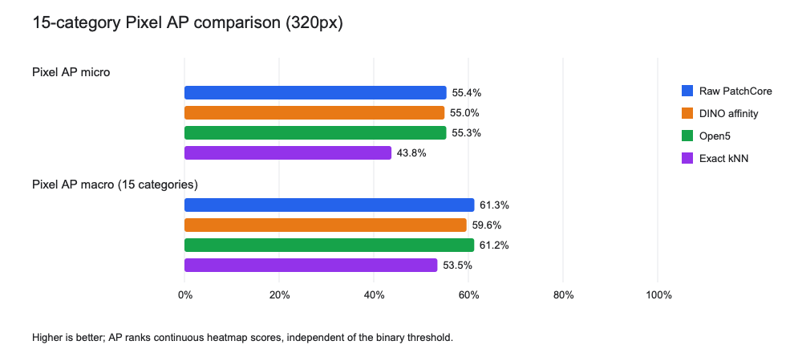

# 15-category heatmap methods (320px)

**Decision:** retain raw PatchCore as the Pixel AP baseline. No tested screw-branch transfer improved Pixel AP; open5 raised Pixel AUROC by only 0.0032 percentage points (micro) and 0.0048 percentage points (macro).

## Protocol

All four methods use the same 15-category train/validation/test manifest, SHA-256 `fac2c931624430c83e1a96f2122691cd5ad319c5f984b43c0bccf5ac7029d432`, with 2,540 train, 1,089 validation and 1,725 test images at 320×320. The effective split has zero exact-hash overlap. Raw PatchCore, open5 and Exact kNN thresholds use known-normal validation pixels at q=.99. The DINO-affinity run's `final_summary.json` references the shared PatchCore threshold. A separate q=.99 known-normal affinity threshold file exists at [`affinity_thresholds/pixel_thresholds.json`](../goal_15_category_postpatch_affinity_320/mvtec_ad/20261126T065220Z/affinity_thresholds/pixel_thresholds.json), but the run summary does not link it and it has no manifest digest; its use for the reported predictions is unverified. Therefore, treat the affinity precision/recall/F1/IoU as provisional and compare methods using threshold-free Pixel AP/AUROC.

The official MVTec test split had already informed prior method and resolution choices. These comparisons are **exploratory**, not an unbiased final estimate; the exact-hash audit does not address near-duplicates or acquisition sessions.

## Results

| Method | Pixel AP micro | Pixel AP macro | Pixel AUROC micro | Precision | Recall | Dice/F1 | Map coverage | Δ micro AP vs raw |
|---|---:|---:|---:|---:|---:|---:|---:|---:|
| Raw PatchCore | 55.38% | 61.28% | 96.26% | 20.11% | 95.33% | 33.21% | 1725/1725 (100.00%) | +0.000 pp |
| DINO affinity | 54.96% | 59.62% | 95.28% | 12.93% | 97.47% | 22.82% | 1725/1725 (100.00%) | -0.416 pp |
| Open5 | 55.35% | 61.24% | 96.27% | 20.01% | 95.42% | 33.08% | 1725/1725 (100.00%) | -0.029 pp |
| Exact kNN | 43.75% | 53.46% | 94.24% | 20.05% | 89.83% | 32.79% | 1722/1725 (99.83%) | -11.625 pp |

[Vector version](pixel_ap_overall.svg)

[Vector version](pixel_ap_by_category.svg)

- **DINO affinity / relation propagation:** threshold-free Pixel AP and AUROC decrease. Its saved production summary points to PatchCore's threshold; a separate affinity-calibrated file exists, but the report does not prove that file was applied. Do not compare threshold-dependent precision, recall, Dice or IoU until the threshold lineage is verified.
- **open5 morphology:** Pixel AP changes by -0.029 percentage points (micro) / -0.036 percentage points (macro); Pixel AUROC rises by 0.0032 percentage points (micro) / 0.0048 percentage points (macro). These near-zero shifts do not justify replacing the simpler raw map.
- **Exact patch kNN:** Pixel AP is lower by over 11 percentage points; 3 UNKNOWN/rejected test images have no map. Do not replace PatchCore for localization.
## Product classification

The unchanged classifier uses frozen DINOv2 global embeddings and multinomial logistic regression (`C=0.1`). The three candidate values of `C` tied at 100% validation macro-F1, so validation is model-selection evidence, not an independent estimate.

| Category | Test images | Correct | Rejected | Top-1 accuracy |
|---|---:|---:|---:|---:|
| bottle | 83 | 83 | 0 | 100.00% |
| cable | 150 | 149 | 1 | 99.33% |
| capsule | 132 | 132 | 0 | 100.00% |
| carpet | 117 | 117 | 0 | 100.00% |
| grid | 78 | 78 | 0 | 100.00% |
| hazelnut | 110 | 110 | 0 | 100.00% |
| leather | 124 | 124 | 0 | 100.00% |
| metal_nut | 115 | 115 | 0 | 100.00% |
| pill | 167 | 167 | 0 | 100.00% |
| screw | 160 | 160 | 0 | 100.00% |
| tile | 117 | 117 | 0 | 100.00% |
| toothbrush | 42 | 42 | 0 | 100.00% |
| transistor | 100 | 98 | 2 | 98.00% |
| wood | 79 | 79 | 0 | 100.00% |
| zipper | 151 | 151 | 0 | 100.00% |
| **All categories** | **1,725** | **1,722** | **3** | **99.826%** |

All three rejected predictions are counted as incorrect. Aggregate accuracy is 100% on the 467 GOOD images and 99.76% on the 1,258 DEFECT images. The 1,089-image validation score is 100%, but it was used for model selection. The official test had been inspected in earlier work, so the test score is exploratory and does not establish performance on an untouched camera/product holdout. See the [full classification report](../goal_15_category_postpatch_raw/mvtec_ad/20261126T062935Z/classification_test_summary.json) and [confusion matrix including UNKNOWN](../goal_15_category_postpatch_raw/mvtec_ad/20261126T062935Z/confusion_matrix_with_unknown.png).

## Screw-method transfer boundary

The tested non-supervised transfers were DINO affinity/relation propagation and morphological opening; neither improved Pixel AP, while open5's AUROC gain was negligible. Exact patch kNN was also weaker for localization. The screw supervised patch-mask refiner requires labeled defect masks. MVTec training data are GOOD-only; using its official test masks to train the refiner would leak evaluation labels. A separate labeled development set is needed before that refiner can be fairly trained and assessed.

## Evidence and QA

- Per-category Pixel AP/AUROC: [`per_category_comparison.csv`](per_category_comparison.csv).
- Machine-readable metrics, split identity and limitations: [`comparison_summary.json`](comparison_summary.json).
- [Raw PatchCore report](../goal_15_category_postpatch_raw/mvtec_ad/20261126T062935Z/final_report.md).
- [DINO-affinity report](../goal_15_category_postpatch_affinity_320/mvtec_ad/20261126T065220Z/final_report.md).
- [open5 report](../goal_15_category_transfer_heatmap_open5_320/mvtec_ad/20261126T101011Z/final_report.md).
- [Exact kNN report](../goal_15_category_exact_patch_knn_320/mvtec_ad/20261126T115930Z/final_report.md).
- Independent QA verified all four runs use the same split manifest and checked metric arithmetic. It also found that the affinity report reuses the raw PatchCore threshold artifact; affinity thresholded metrics should not be compared as calibrated operating points. 24 focused production/unit tests passed before the report was generated.

Limitations: Exact kNN run did not record a source-tree hash; per-image maps were not retained for paired bootstrap intervals; no perceptual/session duplicate audit was run.

## Next action

Keep raw PatchCore locked as the baseline. Do not train the screw refiner from the exposed MVTec masks. Obtain labeled defect development data independent of the evaluation holdout, or collect an untouched production-camera holdout, before training/selecting another learned refiner.
