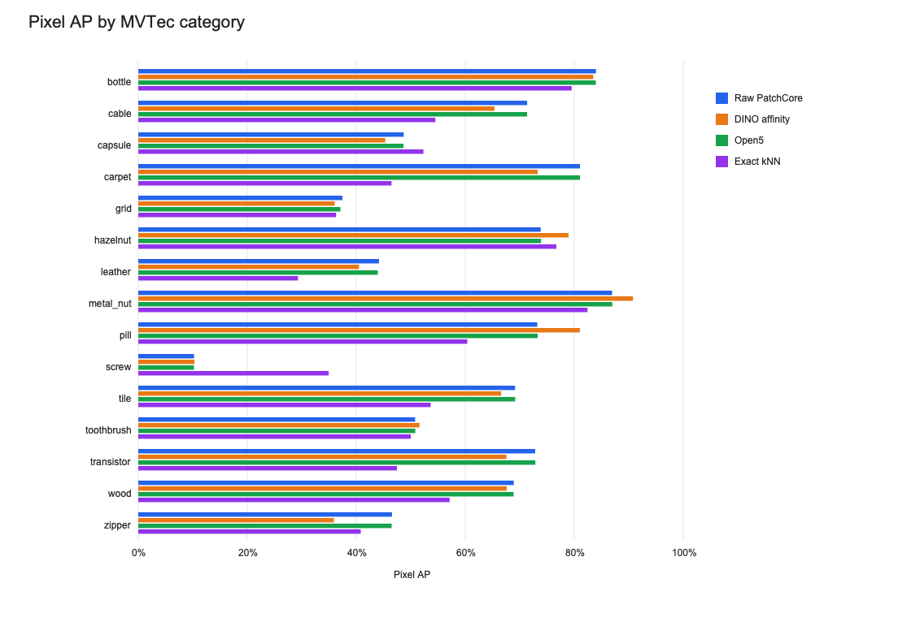

# 15-category heatmap methods (320px)

**Decision:** retain raw PatchCore as the Pixel AP baseline. No tested screw-branch transfer improved Pixel AP; open5 raised Pixel AUROC by only 0.0032 percentage points (micro) and 0.0048 percentage points (macro).

## Protocol

All four methods use the same 15-category train/validation manifest (SHA-256 `fac2c931624430c83e1a96f2122691cd5ad319c5f984b43c0bccf5ac7029d432`; 2,540 train and 1,089 validation images) and the same 1,725 official test images at 320×320. The decoded-pixel inventory over all 5,354 train, validation, and test images has SHA-256 `76ecec7e1a11c95e244f345e7fe4c542cc9778fec5fa839e1f709229cc9df6eb`; the test-only inventory hash is `a88785e62f357832c19188baddb3df95ca252e1257dc6050c26f728c23ac32be`. The decoded-pixel audit finds zero exact cross-split matches; see [`decoded_pixel_split_audit.json`](decoded_pixel_split_audit.json) and its reproducible [audit script](../../../scripts/audit_decoded_pixel_split_duplicates.py). This excludes identical pixel arrays even if their PNG encoding differs. It does not rule out perceptual near-duplicates or acquisition-session leakage. Each method's pixel threshold is calibrated at q=.99 on known-normal validation maps. For DINO affinity, `_calibrate_detector_thresholds` scores maps after the configured refiner and the same in-memory threshold is used during inference. The saved q=.99 affinity threshold snapshot is [`affinity_thresholds/pixel_thresholds.json`](../goal_15_category_postpatch_affinity_320/mvtec_ad/20261126T065220Z/affinity_thresholds/pixel_thresholds.json); its category pixel counts match the validation split at 320×320. The production summary records a detector-level threshold path that has since been overwritten by the later raw PatchCore run, and the affinity snapshot itself has no manifest digest. Thus thresholded metrics use per-method q=.99 validation operating points, but DINO affinity has weaker artifact traceability. Pixel AP and AUROC are threshold-free. Future runs now store non-`none` refiner thresholds under `thresholds/<detector>/refiners/<refiner>` while keeping the legacy raw threshold path unchanged; these historical report paths remain as captured at run time.

The official MVTec test split had already informed prior method and resolution choices. These comparisons are **exploratory**, not an unbiased final estimate; the exact-pixel audit does not address near-duplicates or acquisition sessions.

## Results

| Method | Pixel AP micro | Pixel AP macro | Pixel AUROC micro | Precision | Recall | Dice/F1 | Map coverage | Δ micro AP vs raw |
|---|---:|---:|---:|---:|---:|---:|---:|---:|
| Raw PatchCore | 55.38% | 61.28% | 96.26% | 20.11% | 95.33% | 33.21% | 1725/1725 (100.00%) | +0.000 pp |
| DINO affinity | 54.96% | 59.62% | 95.28% | 12.93% | 97.47% | 22.82% | 1725/1725 (100.00%) | -0.416 pp |
| Open5 | 55.35% | 61.24% | 96.27% | 20.01% | 95.42% | 33.08% | 1725/1725 (100.00%) | -0.029 pp |
| Exact kNN | 43.75% | 53.46% | 94.24% | 20.05% | 89.83% | 32.79% | 1722/1725 (99.83%) | -11.625 pp |

[Vector version](pixel_ap_overall.svg)

[Vector version](pixel_ap_by_category.svg)

- **DINO affinity / relation propagation:** Pixel AP and AUROC decrease. At the per-method q=.99 validation threshold, precision and Dice decrease while recall rises. Its threshold file has weaker run provenance because the shared output path was later overwritten and the sidecar omits the manifest digest.
- **open5 morphology:** Pixel AP changes by -0.029 percentage points (micro) / -0.036 percentage points (macro); Pixel AUROC rises by 0.0032 percentage points (micro) / 0.0048 percentage points (macro). These near-zero shifts do not justify replacing the simpler raw map.
- **Exact patch kNN:** Pixel AP is lower by over 11 percentage points; 3 UNKNOWN/rejected test images have no map. Do not replace PatchCore for localization.
## Product classification

The unchanged classifier uses frozen DINOv2 global embeddings and multinomial logistic regression (`C=0.1`). The three candidate values of `C` tied at 100% validation macro-F1, so validation is model-selection evidence, not an independent estimate.

| Category | Test images | Correct | Rejected | Top-1 accuracy |
|---|---:|---:|---:|---:|
| bottle | 83 | 83 | 0 | 100.00% |
| cable | 150 | 149 | 1 | 99.33% |
| capsule | 132 | 132 | 0 | 100.00% |
| carpet | 117 | 117 | 0 | 100.00% |
| grid | 78 | 78 | 0 | 100.00% |
| hazelnut | 110 | 110 | 0 | 100.00% |
| leather | 124 | 124 | 0 | 100.00% |
| metal_nut | 115 | 115 | 0 | 100.00% |
| pill | 167 | 167 | 0 | 100.00% |
| screw | 160 | 160 | 0 | 100.00% |
| tile | 117 | 117 | 0 | 100.00% |
| toothbrush | 42 | 42 | 0 | 100.00% |
| transistor | 100 | 98 | 2 | 98.00% |
| wood | 79 | 79 | 0 | 100.00% |
| zipper | 151 | 151 | 0 | 100.00% |
| **All categories** | **1,725** | **1,722** | **3** | **99.826%** |

All three rejected predictions are counted as incorrect. Aggregate accuracy is 100% on the 467 GOOD images and 99.76% on the 1,258 DEFECT images. The 1,089-image validation score is 100%, but it was used for model selection. The official test had been inspected in earlier work, so the test score is exploratory and does not establish performance on an untouched camera/product holdout. See the [full classification report](../goal_15_category_postpatch_raw/mvtec_ad/20261126T062935Z/classification_test_summary.json) and [confusion matrix including UNKNOWN](../goal_15_category_postpatch_raw/mvtec_ad/20261126T062935Z/confusion_matrix_with_unknown.png).

## Screw-method transfer boundary

The tested non-supervised transfers were DINO affinity/relation propagation and morphological opening; neither improved Pixel AP, while open5's AUROC gain was negligible. Exact patch kNN was also weaker for localization. The screw supervised patch-mask refiner requires labeled defect masks. MVTec training data are GOOD-only; using its official test masks to train the refiner would leak evaluation labels. A separate labeled development set is needed before that refiner can be fairly trained and assessed.

## Evidence and QA

- Per-category Pixel AP/AUROC: [`per_category_comparison.csv`](per_category_comparison.csv).
- Machine-readable metrics, split identity and limitations: [`comparison_summary.json`](comparison_summary.json).
- [Raw PatchCore report](../goal_15_category_postpatch_raw/mvtec_ad/20261126T062935Z/final_report.md).
- [DINO-affinity report](../goal_15_category_postpatch_affinity_320/mvtec_ad/20261126T065220Z/final_report.md).
- [open5 report](../goal_15_category_transfer_heatmap_open5_320/mvtec_ad/20261126T101011Z/final_report.md).
- [Exact kNN report](../goal_15_category_exact_patch_knn_320/mvtec_ad/20261126T115930Z/final_report.md).
- Independent QA verified the shared train/validation manifest, per-method metrics and threshold calibration source path. A follow-up decoded-pixel audit found no identical pixel arrays across splits; its test inventory hash is recorded above. The historical affinity threshold snapshot is present and calibrated at q=.99, but the production path was overwritten later and the snapshot omits the manifest digest, so its artifact lineage is weaker. 24 focused production/unit tests passed before the comparison report was generated.

Limitations: Exact kNN run did not record a source-tree hash; per-image maps were not retained for paired bootstrap intervals; no reliable perceptual/session duplicate audit was completed.

## Next action

Keep raw PatchCore locked as the baseline. The next **experimental** heatmap candidate is **Dinomaly ViT-Small**, a unified unsupervised reconstruction method; this is not a production switch. Professor compared it with Dinomaly2-B and recommends Small for the first pilot: the paper results differ by about 1.01 Pixel AP points, while the Base-sized Dinomaly2 uses about four times the parameters and MACs of Small. The paper scores are not a forecast for this project and are not directly comparable with our 320px PatchCore results ([CVPR 2025 paper](https://openaccess.thecvf.com/content/CVPR2025/html/Guo_Dinomaly_The_Less_Is_More_Philosophy_in_Multi-Class_Unsupervised_Anomaly_CVPR_2025_paper.html), [Dinomaly2 paper](https://arxiv.org/abs/2510.17611)).

Before benchmarking, the official runner needs a controlled adapter: its MVTec script defaults to the Base encoder, evaluates official test data every 5,000 iterations, and has checkpoint-save calls commented out. It also selects `cuda:1` whenever CUDA exists, which can fail on a single-GPU host, and its evaluation helper resizes masks to 256px. The Small encoder must be selected explicitly; training must read only the pinned GOOD train manifest, use a fixed iteration count, save weights and provenance, and defer test evaluation until training is complete. Use a validated device and this project's 320px evaluator, not the upstream 256px metric path. The pilot should compare all 1,725 test images with raw PatchCore at the same 320px preprocessing and be reported as **exploratory**, because the official test has informed prior method/resolution choices. See the [official Dinomaly implementation](https://github.com/guojiajeremy/Dinomaly) and its [MVTec runner](https://raw.githubusercontent.com/guojiajeremy/Dinomaly/master/dinomaly_mvtec_uni.py).

The current Mac environment is not ready to run that pilot. `DAenv` uses Python 3.13.7, while the official repository documents Python 3.8.12 and pins PyTorch 1.12/CUDA 11.3. A local Torch import did not complete: `torch/lib/libtorch_cpu.dylib` is marked `dataless` and loading stalled at `mmap`; MPS availability therefore remains unverified. No packages have been installed and no model run has started. The pilot should use an isolated CUDA environment and preserve the current production pipeline. Do not train the screw supervised refiner from the exposed MVTec masks; that path needs independent labeled defect-development data.

The final clean-holdout acceptance protocol, proposed data package, public dataset limitations, and pending Project Owner choice are recorded in [`HOLDOUT_REQUIREMENTS.md`](HOLDOUT_REQUIREMENTS.md).
