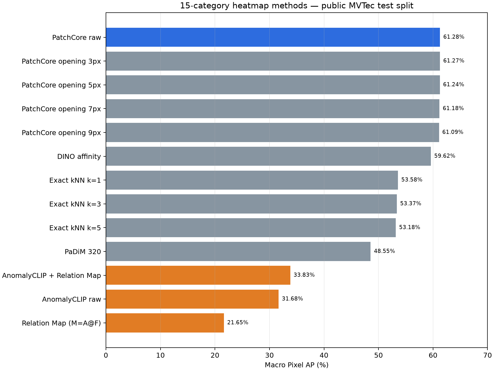

# 15-category heatmap benchmark — consolidated results

## Protocol

- Dataset: processed MVTec AD at 320×320; 15 categories; 1,725 official test images, including 1,258 defect images.
- GOOD fitting split: 2,540 images; GOOD validation split: 1,089 images. Per-category thresholds use validation GOOD pixels only at q=0.99.
- Most score maps use the 320 input setup. AnomalyCLIP uses 336×336 input and maps are resized to the common 320×320 metric grid. Upstream AnomalyCLIP's MVTec test script uses 518px; the local 518px MPS attempt did not finish, so the reported AnomalyCLIP rows are a lower-resolution transfer ablation, not an upstream-resolution reproduction.
- Primary metric: macro Pixel AP, an unweighted mean across 15 categories. AUROC is shown as a secondary ranking metric.
- Every result has full map coverage (1,725/1,725); mask coverage is 1,258/1,258 defect images.
- Exact byte-hash audit found no overlap between train, validation, and official test images. It does not rule out perceptual/session duplicates.
- MVTec official test data has already been inspected in prior work, so results are exploratory rather than an untouched production holdout.

## Unsupervised heatmap methods

| Method | Macro Pixel AP | Macro Pixel AUROC | Setup |
|---|---:|---:|---|
| PatchCore raw | 61.28% | 97.59% | 15-cat 320 run |
| PatchCore opening 3px | 61.27% | 97.59% | 15-cat 320 run |
| PatchCore opening 5px | 61.24% | 97.59% | 15-cat 320 run |
| PatchCore opening 7px | 61.18% | 97.59% | 15-cat 320 run |
| PatchCore opening 9px | 61.09% | 97.60% | 15-cat 320 run |
| DINO affinity | 59.62% | 96.36% | prior 15-cat 320 run |
| Exact kNN k=1 | 53.58% | 96.27% | 15-cat 320 run |
| Exact kNN k=3 | 53.37% | 96.16% | 15-cat 320 run |
| Exact kNN k=5 | 53.18% | 96.08% | 15-cat 320 run |
| PaDiM 320 | 48.55% | 95.66% | 15-cat 320 run |
| AnomalyCLIP + Relation Map | 33.83% | 91.31% | AnomalyCLIP 336, metric grid 320 |
| AnomalyCLIP raw | 31.68% | 88.36% | AnomalyCLIP 336, metric grid 320 |
| Relation Map (M=A@F) | 21.65% | 82.54% | AnomalyCLIP 336, metric grid 320 |

PatchCore raw remains the best general-purpose heatmap in this comparison. The screw-only Relation Map transfer does not generalize across the 15 categories: its macro Pixel AP is substantially lower. Fixed fusion improves over AnomalyCLIP raw by only a small amount and remains well below PatchCore raw.

## Per-category Pixel AP

Scores are percentages. The complete precision CSV is [per_category_pixel_ap_all_methods.csv](per_category_pixel_ap_all_methods.csv).

| Category | PatchCore raw | PatchCore open5 | DINO affinity | Exact kNN k=1 | PaDiM | AnomalyCLIP raw | Relation Map | Fusion |
|---|---:|---:|---:|---:|---:|---:|---:|---:|
| bottle | 83.98% | 83.96% | 83.49% | 79.53% | 79.72% | 53.02% | 19.56% | 59.64% |
| cable | 71.36% | 71.34% | 65.36% | 55.51% | 55.42% | 10.82% | 20.20% | 15.27% |
| capsule | 48.70% | 48.66% | 45.32% | 52.32% | 27.87% | 20.81% | 11.68% | 15.64% |
| carpet | 81.04% | 81.05% | 73.30% | 46.47% | 69.19% | 49.56% | 10.21% | 45.53% |
| grid | 37.46% | 37.10% | 36.03% | 36.30% | 38.87% | 19.79% | 0.86% | 18.08% |
| hazelnut | 73.85% | 73.91% | 78.95% | 76.72% | 55.87% | 39.18% | 22.82% | 42.78% |
| leather | 44.17% | 43.95% | 40.49% | 29.30% | 50.43% | 23.25% | 1.60% | 18.83% |
| metal_nut | 86.95% | 86.98% | 90.78% | 82.43% | 64.08% | 29.51% | 73.42% | 67.06% |
| pill | 73.21% | 73.29% | 81.03% | 60.37% | 36.98% | 32.70% | 46.64% | 32.72% |
| screw | 10.23% | 10.21% | 10.31% | 34.94% | 2.80% | 22.07% | 0.67% | 2.66% |
| tile | 69.15% | 69.16% | 66.57% | 53.64% | 53.04% | 59.64% | 35.43% | 51.62% |
| toothbrush | 50.80% | 50.83% | 51.59% | 50.01% | 37.66% | 15.59% | 11.78% | 28.61% |
| transistor | 72.83% | 72.86% | 67.56% | 48.21% | 66.27% | 13.10% | 42.40% | 21.49% |
| wood | 68.90% | 68.88% | 67.61% | 57.13% | 56.35% | 53.47% | 20.15% | 53.29% |
| zipper | 46.55% | 46.48% | 35.88% | 40.81% | 33.77% | 32.69% | 7.30% | 34.15% |

For screw, Pixel AP is PatchCore raw 10.23%, Exact kNN k=1 34.94%, PaDiM 2.80%, AnomalyCLIP raw 22.07%, Relation Map 0.67%, and fusion 2.66%. Relation Map and fusion are weak on screw despite Relation Map reaching higher AP on metal_nut and pill.

## GOOD-only calibrated binary masks

Thresholds are category- and method-specific q=0.99 values from GOOD validation pixels. `GOOD false-pixel fraction` is the fraction of pixels marked positive in GOOD images; it is distinct from image-level false-positive rate.

| Method | Macro Dice | Macro precision | Macro recall | GOOD false-pixel fraction |
|---|---:|---:|---:|---:|
| PaDiM raw | 42.66% | 35.45% | 71.01% | 1.186% |
| PatchCore raw | 31.58% | 20.82% | 93.95% | 1.464% |
| PatchCore border5 | 32.23% | 21.37% | 93.47% | 1.306% |
| Exact kNN k=1 | 32.05% | 21.77% | 90.62% | 1.464% |
| AnomalyCLIP raw | 29.75% | 25.72% | 54.98% | 0.884% |
| Relation Map | 19.36% | 12.80% | 65.27% | 2.212% |
| Fusion | 34.41% | 38.56% | 39.42% | 1.119% |

PaDiM raw has the highest macro Dice among the compared model outputs. PatchCore border5 is the best tested PatchCore cleanup by macro Dice (32.23%, versus raw 31.58%) and retains higher recall than PaDiM (93.47% versus 71.01%). Choose PaDiM when mask precision/shape balance matters; choose PatchCore border5 when defect-pixel recall is the priority. The table uses macro means across categories; micro aggregate counts are in [binary_mask_postprocess.csv](binary_mask_postprocess.csv). Morphology does not improve continuous Pixel AP.

## Supervised refiner — separate internal split

These numbers are not comparable to the official-test unsupervised table: the refiner trains on 70% of official-test defect images per defect type, validates on 15%, and reports on the remaining 15% plus all official GOOD test images.

| Model | Macro Pixel AP | Macro Pixel AUROC |
|---|---:|---:|
| PatchCore raw on same internal split | 59.43% | 98.90% |
| Default logistic refiner | 73.88% | 99.74% |
| Spatial logistic refiner | 72.70% | 99.71% |
| Spatial decoder | 73.85% | 99.71% |

The default logistic refiner improves macro Pixel AP by 14.46 percentage points on this custom heldout split. This is exploratory evidence, not an official MVTec result; a new external holdout is still needed.

## AnomalyCLIP / Relation Map implementation notes

- AnomalyCLIP raw uses the released prompt checkpoint; Relation Map computes `M=A@F` and compares each test patch against a category GOOD prototype; fusion is the fixed per-image normalized sum (β=1).
- Localization uses the ground-truth category to select its prototype (oracle-category localization), so these are heatmap-only results, not end-to-end product recognition.
- The official AnomalyCLIP test script evaluates the VisA-trained `9_12_4_multiscale/epoch_15.pth` checkpoint on MVTec at 518px. This run used the same checkpoint family for cross-dataset transfer but ran at 336px because the local MPS 518px attempt did not reach scoring; its effect on the reported ranking is unknown. See the [official test script](https://github.com/zqhang/AnomalyCLIP/blob/main/test.sh), [official repository](https://github.com/zqhang/AnomalyCLIP), and retained [518px run status](../goal_15_category_screw_heatmap_transfers_anomalyclip_518_mps_rerun5/RUN_STATUS.md).
- Runtime source checkout: official repository commit `3911738c0867544f545a076ad78f3f11d9ecbfdf`. The run summary records the source tree SHA but leaves the revision field null because provenance was collected through a temporary runner. The checkpoint came from a pinned Hugging Face mirror snapshot (revision `0c8e042`); SHA-256 `94ce202da3e6486a864b904fdfed5057de75846c5834e446fd1d2fe7f97acb44`. CLIP backbone SHA-256 `3035c92b350959924f9f00213499208652fc7ea050643e8b385c2dac08641f02`.
- Pooled micro Pixel AP/AUROC for AnomalyCLIP are intentionally not reported because raw score scales vary by category; use the macro metrics and per-category CSV.

## Artifacts

- AnomalyCLIP detailed report and per-category metrics: [AnomalyCLIP README](../goal_15_category_screw_heatmap_transfers_anomalyclip_336_mps_run2/README.md), [sanitized summary](../goal_15_category_screw_heatmap_transfers_anomalyclip_336_mps_run2/summary_public.json), [metrics.csv](../goal_15_category_screw_heatmap_transfers_anomalyclip_336_mps_run2/metrics.csv), [Pixel AP chart](../goal_15_category_screw_heatmap_transfers_anomalyclip_336_mps_run2/pixel_ap_comparison.png). Sample images, masks, and raw score maps remain local.
- PatchCore/kNN/PaDiM and refiner reports: [main README](README.md), [summary.json](summary.json), [per-category score maps](per_category_score_maps.csv), [supervised heldout metrics](supervised_internal_test.csv), [binary mask postprocessing](binary_mask_postprocess.csv).

The review branch includes the benchmark runner, aggregate metrics, charts, and configurable mask cleanup options. It excludes the dataset, raw score maps, feature banks, model checkpoints, and local environment.
