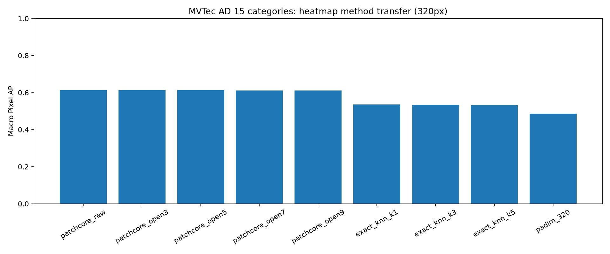
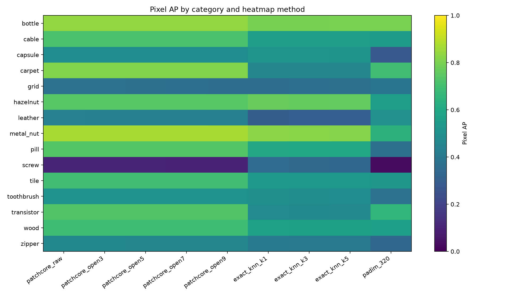

# Screw-only heatmap method transfer to MVTec AD 15 categories

## Protocol and limitations

Unsupervised methods use all 1,725 official MVTec test images at 320×320. Thresholds are q=.99 per category/method from known-GOOD validation maps. The supervised logistic refiners and spatial decoder are trained with GOOD train images and a deterministic 70/15/15 split of official test defect images by category/defect type; their held-out custom split is reported separately and is **not** an official MVTec test score. Earlier project work already inspected the official test, so every result is exploratory. No perceptual-duplicate/session audit or paired bootstrap was run.

## Continuous heatmap results

| Method | Pixel AP macro | Pixel AUROC macro | Pixel AP micro | Pixel AUROC micro |
|---|---:|---:|---:|---:|
| patchcore_raw | 0.6128 | 0.9759 | 0.5538 | 0.9626 |
| patchcore_open3 | 0.6127 | 0.9759 | — | — |
| patchcore_open5 | 0.6124 | 0.9759 | 0.5535 | 0.9627 |
| patchcore_open7 | 0.6118 | 0.9759 | — | — |
| patchcore_open9 | 0.6109 | 0.9760 | — | — |
| exact_knn_k1 | 0.5358 | 0.9627 | — | — |
| exact_knn_k3 | 0.5337 | 0.9616 | — | — |
| exact_knn_k5 | 0.5318 | 0.9608 | — | — |
| padim_320 | 0.4855 | 0.9566 | — | — |

Micro Pixel AP/AUROC for PatchCore raw and open5 are copied from the previously completed full-test comparison. New variants report exact per-category and macro ranking metrics; their micro ranking scores are intentionally omitted to avoid retaining every test map.

## Artifacts

- `per_category_score_maps.csv`: Pixel AP/AUROC and thresholded localization metrics for every continuous method and category.
- `supervised_internal_test.csv`: custom image-disjoint supervised-refiner test metrics.
- `binary_mask_postprocess.csv`: binary precision, recall, Dice, IoU and false-positive measures by category.
- The supervised split manifest, PaDiM statistics, refiner checkpoints, raw score maps, and feature artifacts remain local; they are not included in the GitHub review branch.
