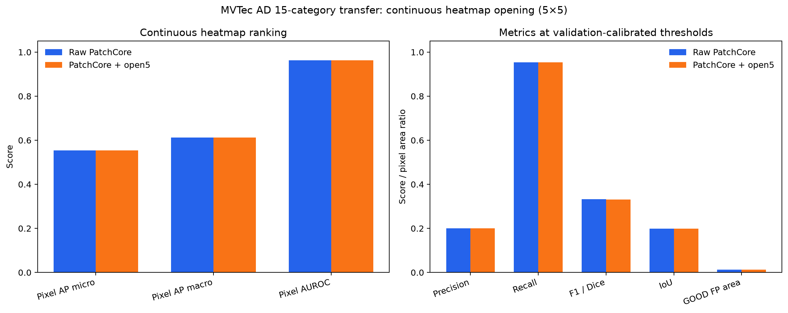
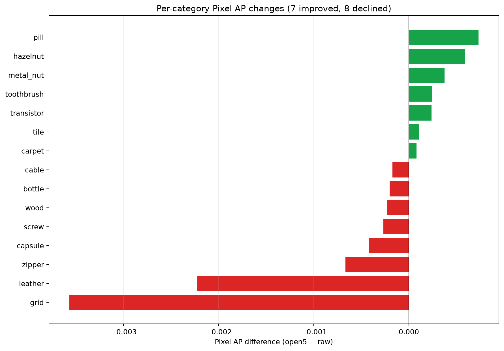

# PatchCore `heatmap_open5` transfer to MVTec AD

**Decision: do not promote `heatmap_open5`. Keep raw PatchCore as the 15-category heatmap baseline.**

This is a controlled **exploratory** comparison on all 15 MVTec AD categories. The official test split has been inspected and used in prior method/resolution choices, so it is not final unbiased generalization evidence.

## Result

| Metric | Raw PatchCore | PatchCore + `heatmap_open5` | Change (open5 − raw) |
|---|---:|---:|---:|
| Pixel AP (micro) | 55.376% | 55.347% | -0.029 pp |
| Pixel AP (macro, 15 categories) | 61.279% | 61.243% | -0.036 pp |
| Pixel AUROC | 96.265% | 96.268% | +0.003 pp |
| Precision | 20.106% | 20.009% | -0.097 pp |
| Recall | 95.327% | 95.416% | +0.089 pp |
| F1 / Dice | 33.208% | 33.081% | -0.127 pp |
| IoU | 19.910% | 19.819% | -0.091 pp |
| GOOD false-positive pixel area | 1.290% | 1.291% | +0.001 pp |
| DEFECT-only Pixel AP | 55.712% | 55.681% | -0.031 pp |
| Product category Top-1 accuracy | 99.826% | 99.826% | unchanged |

The candidate increased pixel recall by only **0.089 percentage points**. Pixel AP, precision, F1/Dice and IoU decreased; GOOD-image false-positive area stayed essentially flat. It does not meet the goal of a meaningfully more accurate or tighter heatmap.

## Per-category results

Pixel AP improved in 7 categories and declined in 8. The macro category mean changed from **0.612793** to **0.612433** (−0.000360). The biggest declines were grid (-0.0036), leather (-0.0022), and zipper (-0.0007). Screw remains weak: 0.1023 → 0.1021.

All per-category AUROC, AP, precision, recall, F1, IoU and GOOD false-positive area values are in [per_category_comparison.csv](per_category_comparison.csv).

## Classification

The 15-class product classifier remains at **99.826%** Top-1 accuracy (1722 accepted, 3 UNKNOWN/rejected among 1725 images). The per-category classification predictions are identical between the two runs because the refiner only changes the continuous localization map. This test result is exploratory for the same prior-exposure reason.

## Protocol and leakage controls

- Same processed 320×320 dataset, 15 categories, 1,725 test images, masks, classifier split, DINOv2, PatchCore layers `(5, 8, 11)`, neighborhood size 3, coreset ratio 0.10, k=1, and raw binary-mask thresholding.
- The only model behavior changed is a 5×5 morphological opening on the upsampled continuous heatmap. Patch scores and image-level scores stay unchanged.
- Each method calibrated category pixel thresholds using `known_normal_validation` at quantile 0.99; no test masks were used to choose thresholds.
- Classification split manifest SHA-256: `fac2c931624430c83e1a96f2122691cd5ad319c5f984b43c0bccf5ac7029d432`. The manifest is byte-identical in both namespaces.
- Independent exact SHA-256 audit: 2540 train, 1089 validation, 1725 test; cross-split exact-hash overlap **0**. See [audit summary](exact_hash_split_audit.json) and [per-file hashes](split_file_hashes.csv).
- Exact hashing does not rule out perceptual near-duplicates or session leakage. More importantly, repeated prior use of the MVTec test split means these scores are exploratory.
- Paired bootstrap confidence intervals were not computed because per-image heatmap arrays were not retained by the production report; treat the small metric deltas as descriptive only.

## Reproduce / inspect

- Full candidate report: [final_report.md](mvtec_ad/20261126T101011Z/final_report.md)
- Candidate configuration and metrics: [final_summary.json](mvtec_ad/20261126T101011Z/final_summary.json)
- Baseline report: [`reports/experiments/goal_15_category_postpatch_raw/mvtec_ad/20261126T062935Z/final_report.md`](../goal_15_category_postpatch_raw/mvtec_ad/20261126T062935Z/final_report.md)
- Baseline GOOD/DEFECT subgroup audit: [`reports/experiments/goal_15_category_postpatch_qa/mvtec_ad/20261126T072127Z/final_report.md`](../goal_15_category_postpatch_qa/mvtec_ad/20261126T072127Z/final_report.md)
- Structured comparison: [comparison_summary.json](comparison_summary.json)
- Per-category comparison: [per_category_comparison.csv](per_category_comparison.csv)
- Artifact and source hashes: [provenance.json](provenance.json)

## Next decision

Keep raw PatchCore as the selected baseline. Keep `heatmap_open5` available only as an explicitly selected experimental refiner so this result is reproducible. Continue with a different candidate selected using independent validation evidence; do not use this repeatedly inspected MVTec test set to tune kernel sizes. A locked external/production-camera holdout is still required for final claims.
