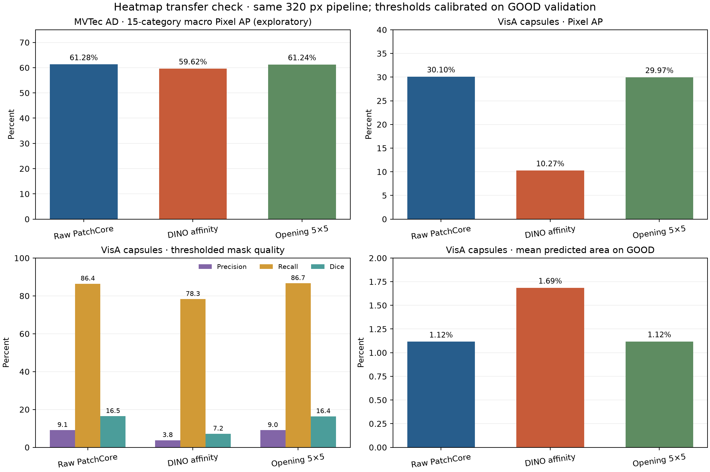
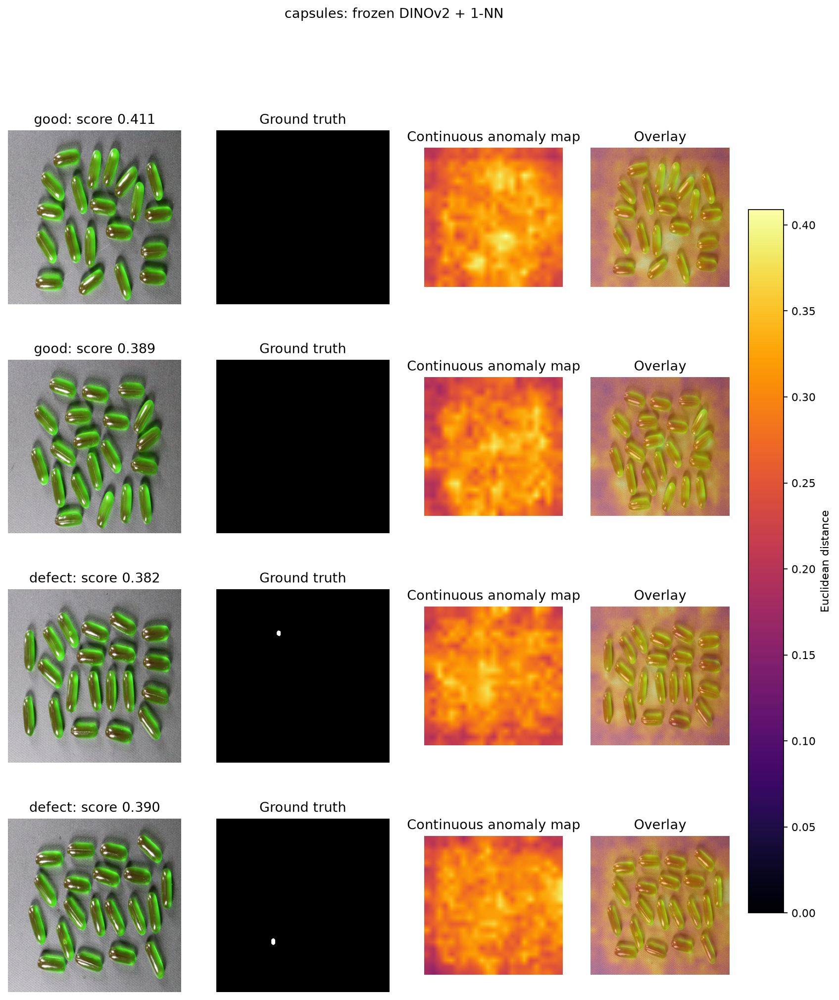

# Báo cáo tiến độ: heatmap 15 categories và classification

## Kết luận hiện tại

- **Classification 15 loại sản phẩm vượt mục tiêu 90% trên MVTec AD:** Top-1 đạt **99.83%** trên 1,725 ảnh test hiện có; nested 5-fold CV đạt **100%** trên 2,540 ảnh `train/good`. Đây là kết quả trong miền MVTec. Test MVTec đã được xem trong các thử nghiệm trước; CV không có ID vật thể/phiên chụp và chỉ gồm GOOD, nên chưa chứng minh độ chính xác trên sản phẩm, camera hoặc phiên chụp mới.
- **Chưa tìm thấy phương pháp heatmap mới cải thiện raw PatchCore.** Trên MVTec AD 15 categories, raw PatchCore vẫn dẫn đầu về macro Pixel AP. Trên holdout chéo miền VisA `capsules`, raw PatchCore cũng tốt hơn DINO affinity và opening 5×5.
- **Giữ raw PatchCore làm baseline heatmap.** Chưa đổi cấu hình production. DINO affinity bị loại khỏi vai trò ứng viên mặc định; opening 5×5 gần như trung tính nhưng không cải thiện AP.



## Classification 15 categories

| Đánh giá | Kết quả | Diễn giải |
|---|---:|---|
| MVTec AD official test, 1,725 ảnh | Top-1 **99.83%**; 3 ảnh bị reject tính là sai | GOOD 100%; DEFECT 99.76%. Test này đã tham gia các vòng đánh giá trước, nên chỉ là kết quả in-domain đã biết. |
| Nested 5-fold CV trên `train/good`, 2,540 ảnh | Top-1 **100%**, macro Top-1 **100%**, macro-F1 **100%** | Không thấy leakage giữa inner/outer folds. Chỉ đánh giá GOOD; exact-pixel grouping không thể gom cùng vật thể hay cùng phiên chụp vì dataset không có ID đó. |

Nested CV không chọn được classifier tốt hơn: logistic regression được chọn ở cả 5 fold và cùng đạt 100%. Giữ classifier hiện tại. Chi tiết nằm trong [báo cáo CV](../goal_15_category_classification_nested_cv/README.md) và [báo cáo classification trên test MVTec](../goal_15_category_postpatch_raw/mvtec_ad/20261126T062935Z/classification_test_summary.json).

Không diễn giải classification một category của VisA thành kết quả 15-class. Trong thử nghiệm `capsules`, module product classification được tắt vì chỉ có một category.

## So sánh heatmap trên MVTec AD

Đây là 15 category, 1,725 ảnh test, heatmap 320×320. MVTec test đã ảnh hưởng đến lựa chọn trước đó; các con số dưới đây là exploratory.

| Phương pháp | Macro Pixel AP | Chênh so với raw | Macro Pixel AUROC | Precision / Recall / Dice tại operating point |
|---|---:|---:|---:|---:|
| Raw PatchCore | **61.279%** | — | **97.585%** | 20.11% / 95.33% / 33.21% |
| DINO affinity | 59.618% | −1.661 điểm % | 96.361% | 12.93% / 97.47% / 22.82% |
| Opening 5×5 | 61.243% | −0.036 điểm % | 97.590% | 20.01% / 95.42% / 33.08% |
| Exact patch kNN | 53.464% | −7.815 điểm % | 96.239% | 20.05% / 89.83% / 32.79% |

Pixel AP là metric xếp hạng chính; threshold không tác động trực tiếp lên AP. Affinity làm AP và Dice giảm. Opening 5×5 chỉ đổi kết quả rất ít, với AP thấp hơn raw. Bảng theo category và audit nằm trong [báo cáo phương pháp 15 categories](../goal_15_category_heatmap_methods_320/README.md).

## Holdout chéo miền VisA `capsules`

VisA có nhãn ảnh và mask pixel. Subset `capsules` gồm nhiều viên trong một ảnh; split 1-class chính thức có 542 ảnh normal train, 60 normal test và 100 anomaly test. Dataset phát hành theo CC BY 4.0 ([repo chính thức](https://github.com/amazon-science/spot-diff)).

### Protocol

- Dùng official `split_csv/1cls.csv`; 542 ảnh normal train được tách bằng seed 42 thành **379 ảnh train feature bank** và **163 ảnh GOOD validation**.
- Dùng validation GOOD để hiệu chỉnh ngưỡng riêng từng phương pháp tại quantile **q=0.99**. Không dùng mask/label test để train hoặc chọn threshold.
- Đánh giá cùng 160 ảnh test (60 GOOD, 100 DEFECT) ở 320×320; kiểm tra 100 mask defect. Split audit cho thấy 702 ảnh train/validation/test có hash pixel giải mã duy nhất, **0 cặp trùng pixel xuyên split**.
- DINOv2 ViT-B/14 đóng băng, revision `7764ea0f912e53c92e82eb78a2a1631e92725fc8`; PatchCore dùng feature từ block 5/8/11, coreset 10%; chạy trên MPS.
- Đã so sánh cả ba ứng viên trên public test để chọn phương pháp tiếp tục. Vì vậy đây là **kết quả thăm dò**, không phải sealed-test estimate. Audit chỉ phát hiện trùng pixel chính xác; không có ID vật thể/phiên chụp để kiểm tra nhóm.

### Kết quả

| Phương pháp | Pixel AP | Pixel AUROC | Threshold q99 | Precision | Recall | Dice | IoU | Diện tích dự đoán nhầm trung bình trên GOOD |
|---|---:|---:|---:|---:|---:|---:|---:|---:|
| Raw PatchCore | **30.104%** | 97.636% | 0.38559 | **9.10%** | 86.43% | **16.46%** | **8.97%** | **1.116%** |
| DINO affinity | 10.272% | 93.475% | 0.33958 | 3.76% | 78.30% | 7.17% | 3.72% | 1.685% |
| Opening 5×5 | 29.969% | **97.654%** | 0.38454 | 9.05% | **86.69%** | 16.38% | 8.92% | 1.118% |

Affinity kém raw rõ rệt. Opening 5×5 tăng recall 0.26 điểm %, nhưng giảm AP 0.14 điểm % và Dice 0.08 điểm %; đây không phải cải thiện tổng thể. Raw PatchCore vẫn là kết quả tốt nhất trong ba cách đã kiểm tra.

Pixel AP thấp dù AUROC cao. Ví dụ trực quan cho thấy map trải rộng trên nền và nhiều viên GOOD, trong khi mask defect có thể chỉ gồm vài pixel. Điều này giải thích precision/Dice thấp và cho thấy AUROC đơn lẻ không đủ để kết luận vị trí defect đã chính xác.



## Vì sao chưa chuyển supervised refiner từ screw

Professor kiểm tra các kết quả đã lưu của branch screw. Trong cùng phép so sánh trên screw, supervised patch refiner đạt Pixel AP 47.21% so với AnomalyCLIP gốc 13.94%, nhưng đây là kết quả trên tập supervised-development 480 ảnh của screw, không thể so trực tiếp với MVTec/VisA. Mặt nạ GOOD vẫn có false alarm theo ảnh rất cao.

Refiner cần defect masks thật trong train. MVTec AD chỉ có ảnh GOOD trong train; defect masks nằm trong official test đã bị dùng trong nghiên cứu trước. Dùng các mask đó để train refiner rồi báo cáo test trên cùng nguồn sẽ gây leakage. Vì vậy chưa chuyển refiner qua 15 categories. Cần thu thập defect masks train/validation độc lập trước khi thử.

## Artefact và tái lập

- [Bảng benchmark VisA](comparison.csv)
- [Audit duplicate theo decoded pixels](split_audit.json)
- [Provenance, checksum và cấu hình](provenance.json)
- [Script chuẩn hóa subset capsules](prepare_capsules.py)
- [Runner chạy raw, affinity, open5](../../../scripts/run_visa_capsules_holdout.sh)
- [Raw PatchCore report](raw/visa_capsules_mvtetc/20261126T165100Z/final_report.md)
- [DINO affinity report](dino_affinity/visa_capsules_mvtetc/20261126T165453Z/final_report.md)
- [Opening 5×5 report](open5/visa_capsules_mvtetc/20261126T165630Z/final_report.md)

Dataset, processed images, feature bank và model cache được giữ ngoài Git. Runner dùng Python environment tách riêng; đặt biến `PYTHON` trỏ tới Python có Torch/Pillow/scikit-learn/OpenCV và truyền đường dẫn dataset đã chuẩn hóa. Runner đã qua `bash -n`; ba cấu hình trong báo cáo này được chạy riêng qua cùng `scripts/run_production.py` với cùng seed, split, resolution và MPS. `prepare_capsules.py` khóa hash của official split CSV trước khi ghi output; một CSV bị sửa đã được kiểm tra và bị từ chối trước khi tạo thư mục dữ liệu.

Để tái lập từ archive VisA, tải archive và split CSV chính thức, giải nén riêng thư mục `capsules`, chạy script chuẩn hóa rồi chạy runner:

```bash
curl -L 'https://amazon-visual-anomaly.s3.us-west-2.amazonaws.com/VisA_20220922.tar' -o /tmp/VisA_20220922.tar
curl -L 'https://raw.githubusercontent.com/amazon-science/spot-diff/main/split_csv/1cls.csv' -o /tmp/visa_1cls.csv
mkdir -p /tmp/visa_raw
tar -xf /tmp/VisA_20220922.tar -C /tmp/visa_raw capsules
python reports/experiments/goal_heatmap_external_visa/prepare_capsules.py \
  --raw-root /tmp/visa_raw --split-csv /tmp/visa_1cls.csv \
  --output-root /tmp/visa_capsules_mvtetc
PYTHON=/absolute/path/to/python bash scripts/run_visa_capsules_holdout.sh \
  /tmp/visa_capsules_mvtetc
```

Runner cần checkpoint và source DINOv2 đã có trong `artifacts/production_highres/mvtec_ad/torch_hub`; các artifact của lượt chạy được tạo trong thư mục tạm. Kết quả hiện tại dùng archive **1,929,840,640 bytes** và hash được ghi trong `provenance.json`. Dataset VisA không được thêm vào Git.

## Việc còn lại

1. Chưa có heatmap method nào vượt raw PatchCore trên cả đánh giá 15 categories lẫn pilot VisA; do đó mục tiêu cải thiện heatmap 15 categories **chưa hoàn thành**.
2. Classification đạt >90% trên MVTec, nhưng cần kiểm chứng trên ảnh defect và UNKNOWN từ các vật thể/phiên chụp hoặc camera độc lập.
3. Để train supervised refiner, cần tập defect có pixel masks tách theo vật thể/phiên chụp vào train, validation và sealed test. Không dùng lại MVTec test masks để train.
4. Các gate định lượng về mức tăng AP, binary-mask recall/false-positive area, UNKNOWN false-accept và tỷ lệ reject vẫn cần Project Owner chốt trước nghiệm thu cuối. Xem [yêu cầu holdout](../goal_15_category_heatmap_methods_320/HOLDOUT_REQUIREMENTS.md).
